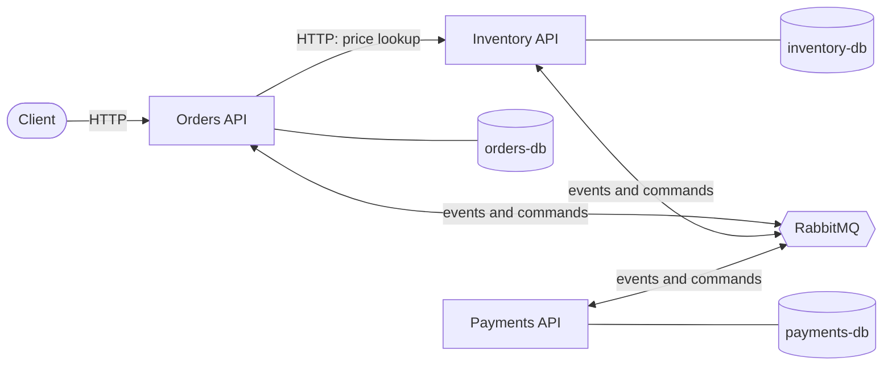

# OrderFlow


OrderFlow is an event-driven order system in .NET 10. It has three services (Inventory, Orders and Payments). Each one owns its own PostgreSQL database, and they talk to each other through RabbitMQ using MassTransit.

## Why it is built this way

- **Messages instead of direct calls.** Orders does not need Payments or Inventory to be up to accept an order. Work waits safely in queues and finishes when the other service is back.
- **No lost events.** Every service writes outgoing messages to an outbox table in the same database transaction as its data. A background process then delivers them, so a crash only delays a message and never loses it.
- **No double work.** Delivery is at-least-once, so consumers are idempotent. Each one runs inside a transaction with an inbox that skips messages it has already handled.
- **One coordinator for each order.** A saga (state machine) in Orders drives every order to Confirmed, Failed or Cancelled. It compensates when payment fails by releasing the reserved stock, without a distributed transaction.
- **No overselling.** Stock updates use optimistic concurrency (PostgreSQL `xmin`). When two orders race for the last unit, exactly one wins.

## Architecture



The full message flows are in [docs/order-flow.md](docs/order-flow.md), and the saga is described in [docs/order-saga.md](docs/order-saga.md).

## Services

| Service | Port on your machine | Database (host port) | Responsibility |
|---|---|---|---|
| Inventory | 5213 | inventory-db (5434) | Products and stock: create, update, delete, reserve and release |
| Orders | 5214 | orders-db (5433) | Accepts orders, runs the order saga, keeps order status |
| Payments | 5215 | payments-db (5435) | Simulated charge, with a switch to force failures |
| RabbitMQ | 5672, management UI on 15672 | | Message broker |

Every service has the same four layers (Api, Application, Domain, Infrastructure), and shared message types live in `src/Contracts`. See [docs/project-references.md](docs/project-references.md).

```
src/
  Contracts/                 shared messages (events and commands)
  Inventory/                 OrderFlow.Inventory.{Api,Application,Domain,Infrastructure}
  Orders/                    OrderFlow.Orders.{Api,Application,Domain,Infrastructure}
  Payments/                  OrderFlow.Payments.{Api,Application,Domain,Infrastructure}
tests/
  OrderFlow.Inventory.Tests              unit tests (validation)
  OrderFlow.Orders.Tests                 unit tests (order status rules) and saga harness tests
  OrderFlow.Inventory.IntegrationTests   API, consumer and concurrency tests on real PostgreSQL
docs/                        design notes, diagrams, decisions, drills
```

## Inventory API (http://localhost:5213)

| Method | Route | Success | Errors |
|---|---|---|---|
| GET | /ping | 200 | |
| GET | /health | 200 Healthy | 503 when the database is down |
| GET | /api/inventory | 200 | |
| GET | /api/inventory/{id} | 200 | 404 |
| GET | /api/inventory/by-sku/{sku} | 200 | 404 |
| POST | /api/inventory | 201 + Location | 400 (validation), 409 (duplicate SKU) |
| PUT | /api/inventory/{id} | 200 | 400, 404 |
| DELETE | /api/inventory/{id} | 204 | 404 |

The rules are: the SKU is required, at most 64 characters, letters, digits and `-` only. The name is required and at most 200 characters. Quantity and price cannot be negative. Errors come back as ProblemDetails.

Requests are in `src/Inventory/OrderFlow.Inventory.Api/inventory.http`. Requests 20 and 21 seed a keyboard (KB-001) and a mouse (MS-002), and request 23 seeds a single last unit for the concurrency demo.

## Orders API (http://localhost:5214)

| Method | Route | Success | Errors |
|---|---|---|---|
| GET | /ping | 200 | |
| GET | /health | 200 Healthy | 503 when the database is down |
| GET | /api/orders?page=1&pageSize=10 | 200 (items, page, pageSize, totalCount, totalPages) | 400 (page < 1, pageSize outside 1 to 100) |
| GET | /api/orders/{id} | 200 | 404 |
| POST | /api/orders | 201 + Location, status Pending | 400 (validation, unknown SKU) |

Prices come from Inventory at the moment the order is created. The order then moves on asynchronously, and its status becomes Confirmed, Failed or Cancelled a moment later. Requests are in `src/Orders/OrderFlow.Orders.Api/orders.http`.

## Payments API (http://localhost:5215)

| Method | Route | Success |
|---|---|---|
| GET | /ping | 200 |
| GET | /health | 200 Healthy |

Payments has no business endpoints. It works only through messages (ChargePayment in, PaymentCompleted or PaymentFailed out).

Interactive API docs (OpenAPI and Scalar) are at `/scalar` on Inventory and Orders. The raw JSON is at `/openapi/v1.json`.

## Messaging

| Message | Kind | Sent by | Handled by |
|---|---|---|---|
| OrderSubmitted | event | Orders (through its outbox) | Inventory, Orders saga |
| StockReserved | event | Inventory | Orders saga |
| StockReservationFailed | event | Inventory | Orders saga |
| ChargePayment | command (queue `ChargePayment`) | Orders saga | Payments |
| PaymentCompleted | event | Payments | Orders saga |
| PaymentFailed | event | Payments | Orders saga |
| ReleaseStock | command (queue `ReleaseStock`) | Orders saga | Inventory |
| StockReleased | event | Inventory | Orders saga |
| OrderConfirmed | event | Orders saga | Orders (updates the order row) |
| OrderCancelled | event | Orders saga | Orders (updates the order row) |
| OrderFailed | event | Orders saga | Orders (updates the order row) |

Reliability rules that apply to every service:

- **Outbox.** Messages are written to an `OutboxMessage` table in the same transaction as the data, then delivered by a background process (MassTransit EF Core outbox).
- **Transactional consumers.** Each consumer runs inside one database transaction, together with its outgoing messages. A failure rolls back both.
- **Inbox.** MassTransit's `InboxState` table skips messages that were already handled. Payments also keeps its own `processed_messages` table for `ChargePayment`.
- **Retries.** A failing message is retried 5 times with growing waits (exponential backoff). If it still fails, it lands in a queue ending in `_error`.
- **Concurrency.** Stock rows and saga rows use PostgreSQL `xmin` as a concurrency token. A conflicting update throws, is retried, and then sees fresh data.

More detail is in [docs/reliability.md](docs/reliability.md).

## How to run

Prerequisites: Docker Desktop. You also need the .NET 10 SDK if you want to run the tests or the services outside Docker.

1. Clone the repository and open a terminal in its folder.
2. Copy `.env.example` to `.env` and set the passwords.
3. Start everything:

   ```
   docker compose up --build -d
   ```

4. Check that everything is running or healthy:

   ```
   docker compose ps
   ```

5. Check each service. Each one should answer `Healthy`:
   - http://localhost:5213/health (Inventory)
   - http://localhost:5214/health (Orders)
   - http://localhost:5215/health (Payments)
6. Seed two products with `inventory.http` requests 20 and 21. Then place an order with `orders.http` request 02, and check with request 03 that it becomes Confirmed.
7. The RabbitMQ management page is at http://localhost:15672 (use the user and password from `.env`).
8. Stop with `docker compose down`. Add `-v` to also delete all data.

Database migrations run automatically on startup in Docker (`Database__MigrateOnStartup=true`).

### Demo switches (development only)

| Variable in your shell | Effect |
|---|---|
| `PAYMENT_FORCE_FAILURE=true` | Every payment fails, so you can watch compensation (order Cancelled, stock released) |
| `CHAOS_CRASH_BEFORE_PUBLISH=true` | Orders crashes right after saving an order, so you can watch the outbox deliver the event after a restart |

Set the variable, then recreate the one service. For example, in PowerShell: `$env:PAYMENT_FORCE_FAILURE = "true"`, then `docker compose up -d payments-api`. Remove the variable and recreate the service again to switch it off.

## Running the tests

- All tests: `dotnet test`. Docker must be running, because the integration tests start a real PostgreSQL with Testcontainers.
- Fast tests only (no Docker): `dotnet test --filter "FullyQualifiedName!~IntegrationTests"`
- Integration tests only: `dotnet test --filter "FullyQualifiedName~IntegrationTests"`
- Saga tests only: `dotnet test --filter "Category=Saga"`
- Concurrency test only: `dotnet test --filter "Category=Concurrency"`

What is covered:

- Unit tests for validation and for the order status rules (an order only changes state while it is Pending).
- Saga tests with the MassTransit test harness: the happy path, compensation, and a late PaymentCompleted after a cancel, which is flagged and never obeyed.
- Integration tests that start the real Inventory API on a throwaway PostgreSQL container.
- Consumer tests: the real `OrderSubmittedConsumer` with an in-memory bus and a real database.
- A last-unit concurrency test that fails if the `xmin` concurrency token is removed.

CI runs restore, build and all tests on every push (see [.github/workflows/ci.yml](.github/workflows/ci.yml) and [docs/ci.md](docs/ci.md)).

## Known gaps

These are honest limits of the current version:

- **Price lookup is synchronous HTTP.** Creating an order needs Inventory to be up. Everything after that is asynchronous.
- **No idempotency key on POST /api/orders.** If Orders crashes after saving an order but before answering, the client sees an error and may retry, which creates a second order.
- **No refunds.** A late PaymentCompleted after an order was cancelled is only flagged (`NeedsRefund` in the saga row).
- **No saga timeouts.** An order whose message lands in an error queue, or whose payment never answers, stays Pending. Error queues are inspected by hand.
- **Two inboxes overlap in Payments** (MassTransit's `InboxState` and the older `processed_messages` table).
- **No authentication yet.** That is coming in Week 12: JWT, roles and a gateway.

Coming next: JWT authentication and roles, a YARP gateway with rate limiting, then an AI-powered search service.

## Docs

- [docs/project-references.md](docs/project-references.md): how the projects reference each other
- [docs/containers.md](docs/containers.md): what runs in Docker and how containers find each other
- [docs/monolith-vs-microservices.md](docs/monolith-vs-microservices.md): trade-offs, from experience
- [docs/order-flow.md](docs/order-flow.md): sequence diagrams for every order outcome, and the order status
- [docs/message-flow.md](docs/message-flow.md): every message, who sends it and who handles it
- [docs/order-saga.md](docs/order-saga.md): the saga design, the event rules, and what is implemented
- [docs/dual-write.md](docs/dual-write.md): the dual-write problem, reproduced and fixed
- [docs/concurrency.md](docs/concurrency.md): the last-unit race and optimistic concurrency
- [docs/reliability.md](docs/reliability.md): every reliability fix, with how to prove it
- [docs/drills.md](docs/drills.md): kill-a-service drills, expected vs actual
- [docs/decisions.md](docs/decisions.md): decision records (outbox, saga, concurrency)
- [docs/ci.md](docs/ci.md): the CI pipeline

## Tech stack

.NET 10, ASP.NET Core Minimal APIs, EF Core with Npgsql, PostgreSQL 16, RabbitMQ 4, MassTransit 8 (pinned to 8.5.x, because version 9 is commercial), xUnit, Testcontainers, Docker Compose, GitHub Actions, OpenAPI with Scalar.
