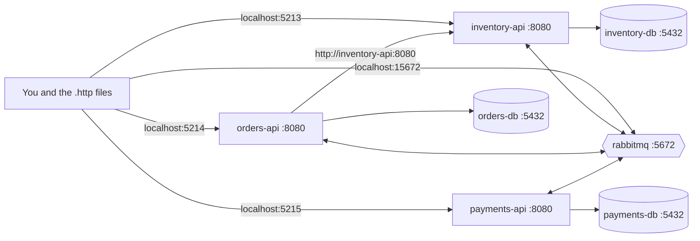

# What runs

`docker compose up --build -d` starts eight containers on one Docker network.

| Container | Image | Port on your machine | Port inside the network |
|---|---|---|---|
| orderflow-inventory-api | built from src/Inventory/OrderFlow.Inventory.Api/Dockerfile | 5213 | 8080 |
| orderflow-orders-api | built from src/Orders/OrderFlow.Orders.Api/Dockerfile | 5214 | 8080 |
| orderflow-payments-api | built from src/Payments/OrderFlow.Payments.Api/Dockerfile | 5215 | 8080 |
| orderflow-inventory-db | postgres:16 | 5434 | 5432 |
| orderflow-orders-db | postgres:16 | 5433 | 5432 |
| orderflow-payments-db | postgres:16 | 5435 | 5432 |
| orderflow-rabbitmq | rabbitmq:4-management | 5672 and 15672 | 5672 |

## Rules worth remembering

- **Names, not localhost, between containers.** Inside the network, containers find each other by service name (`inventory-api`, `orders-db`, `rabbitmq`). Inside a container, `localhost` means the container itself.
- **Mapped ports are only for you.** The left port (5213) is on your machine, and the right port (8080) is inside the network. Containers always use the inside port.
- **Healthchecks and depends_on.** The databases and RabbitMQ have healthchecks, and each API waits until its database and the broker are healthy before it starts.
- **Configuration through environment variables.** Compose sets `ConnectionStrings__...`, `RabbitMq__...` and `Database__MigrateOnStartup=true`. Passwords come from `.env`, which is never committed (`.env.example` is the template).
- **Multi-stage Dockerfiles.** The SDK image restores and publishes, and the smaller ASP.NET runtime image runs the result. The `.csproj` files are copied before the source, so the restore layer is cached between builds.
