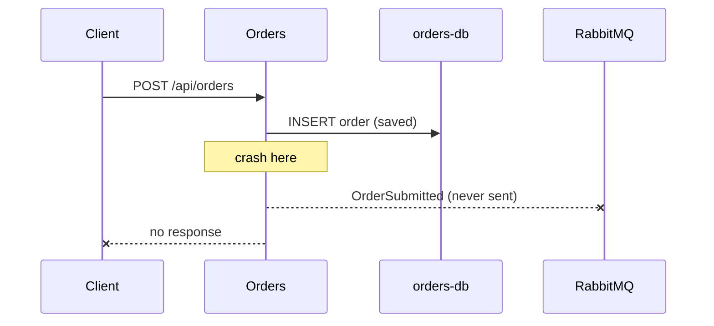
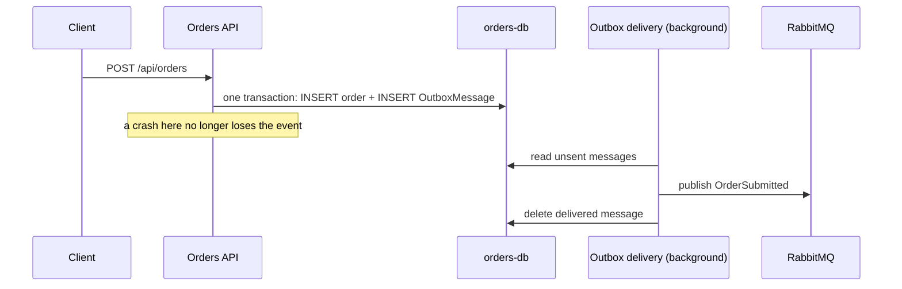

# The dual-write problem

## What it was

Orders used to save the order and then publish `OrderSubmitted`, as two separate steps. PostgreSQL and RabbitMQ share no transaction. A crash between the two steps left the order saved but the event never sent, and nothing ever retried it. The order stayed Pending forever, with no stock reserved, no payment, and no error anywhere.

Swapping the two steps does not help. If you publish first and crash before saving, the other services hear about an order that does not exist.



## After the outbox

Orders now writes the event as a row in its own `OutboxMessage` table, in the same transaction as the order, so either both are saved or neither is. A background delivery process inside Orders publishes unsent rows to RabbitMQ and deletes them once the broker has accepted them. A crash now only delays the event: after the restart, the row is still there and gets delivered.



In the endpoint, `Publish` is called before `SaveChangesAsync`. It no longer talks to RabbitMQ. It only adds an outbox row to the same DbContext, and the single save writes everything at once.

## Consumers too

The same hole existed inside consumers. Inventory saved the reduced stock and then published `StockReserved`. When it failed right after that, the stock stayed reduced, the retry saw different data, and two contradictory events went out (`StockReserved` and `StockReservationFailed`).

With the outbox on every consumer endpoint, each consumer runs inside one database transaction. A failure rolls back the stock change and the parked outgoing message together. Re-running the same poison order (quantity 13) left the stock unchanged and published nothing. The message ended in the error queue after its retries.

## How to reproduce

1. Start the system and seed Inventory (`inventory.http` requests 20 and 21).
2. Turn on the crash switch and recreate Orders:

   ```
   $env:CHAOS_CRASH_BEFORE_PUBLISH = "true"
   docker compose up -d orders-api
   ```

3. Send `orders.http` request 02. The request fails, `orders-api` exits, and the log shows `CHAOS: crashing after saving order ...`.
4. Turn the switch off and restart Orders:

   ```
   Remove-Item Env:CHAOS_CRASH_BEFORE_PUBLISH
   docker compose up -d orders-api
   ```

5. Check that order (request 03). Before the outbox it stayed Pending forever. Now it becomes Confirmed a few seconds after the restart.

To see a message waiting in the outbox, stop RabbitMQ (`docker compose stop rabbitmq`), place an order (it still returns 201), and run `SELECT * FROM "OutboxMessage";` in the orders database. Start RabbitMQ again and the row disappears.

## What is still true

If Orders crashes after the save but before the response, the client gets an error even though the order exists. A client retry would then create a second order. Fixing that needs an idempotency key on the request.
