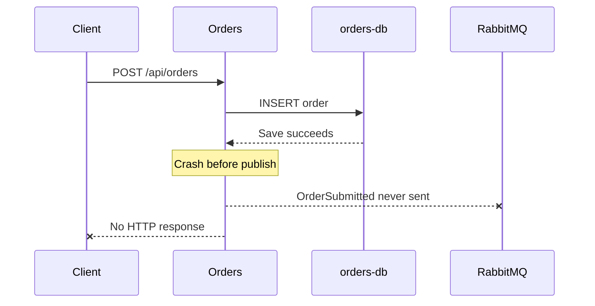

# The Dual-Write Problem

## What happens

The Orders API saves an order to PostgreSQL and then publishes an `OrderSubmitted` event to RabbitMQ as two separate operations.

## Why this can lose an event

PostgreSQL and RabbitMQ do not share a transaction in this flow. If Orders crashes after the database save but before publishing the event, the order remains saved while the event is never sent. Since no message was published, RabbitMQ cannot retry it.

## Impact

The order can remain `Pending` indefinitely. Inventory does not reserve its stock, Payments does not receive a charge request, and the system may not have an obvious error indicating that the order is stuck.

## Failure sequence



## How to reproduce

In PowerShell, from the project directory:

1. Enable the crash switch:

   ```powershell
   $env:CHAOS_CRASH_BEFORE_PUBLISH = "true"
   ```

2. Rebuild and recreate Orders:

   ```powershell
   docker compose up --build -d --force-recreate orders-api
   ```

3. Check `docker compose config` and confirm `Chaos__CrashBeforePublish` resolves to `true`.

4. Watch the Orders logs:

   ```powershell
   docker compose logs -f orders-api
   ```

5. Send request 02 in `orders.http`. Capture the CHAOS log and order ID.

6. Turn off the switch and restart Orders:

   ```powershell
   Remove-Item Env:CHAOS_CRASH_BEFORE_PUBLISH -ErrorAction SilentlyContinue
   docker compose up -d --force-recreate orders-api
   ```

7. Check the Orders database, request 03, Inventory logs and RabbitMQ to verify the outcome.

## Shutdown terminology

- `docker compose stop` requests a graceful shutdown, giving the application an opportunity to finish work.
- `docker compose kill` sends a hard-stop signal to the container.
- `Environment.FailFast` terminates the .NET process immediately, without normal graceful shutdown.

A real process failure can occur at many points, not only between saving an order and publishing its event.

## Planned fix

Session 47 introduces a transactional outbox: the order and its outgoing event record are saved in the same database transaction, and a background publisher sends the event to RabbitMQ later.