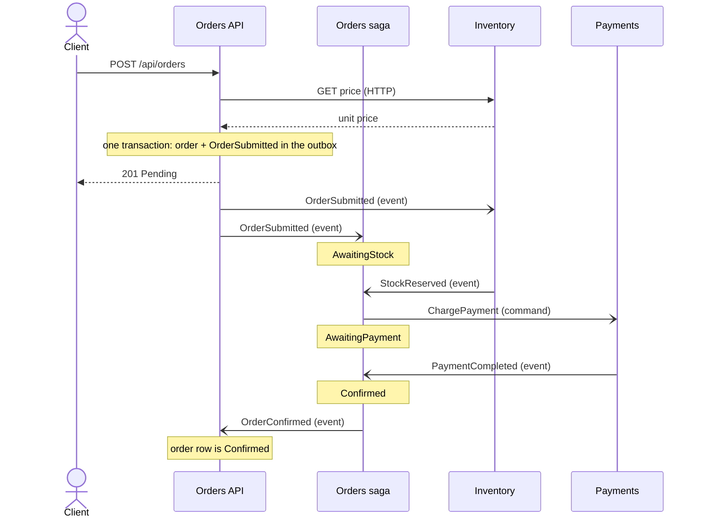
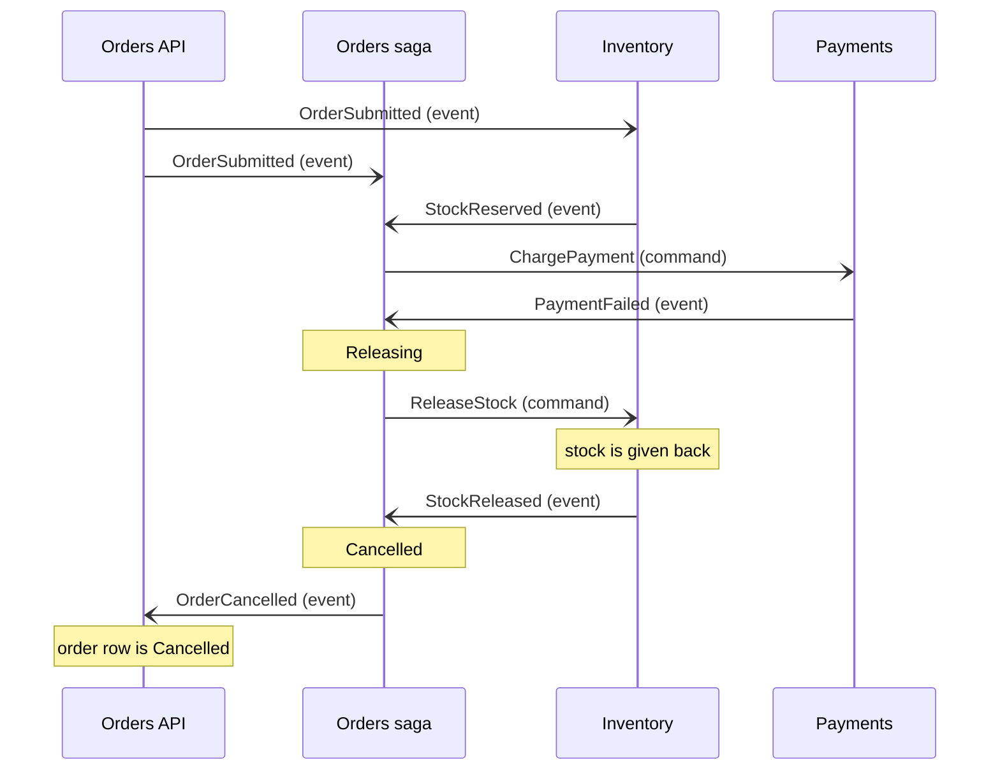
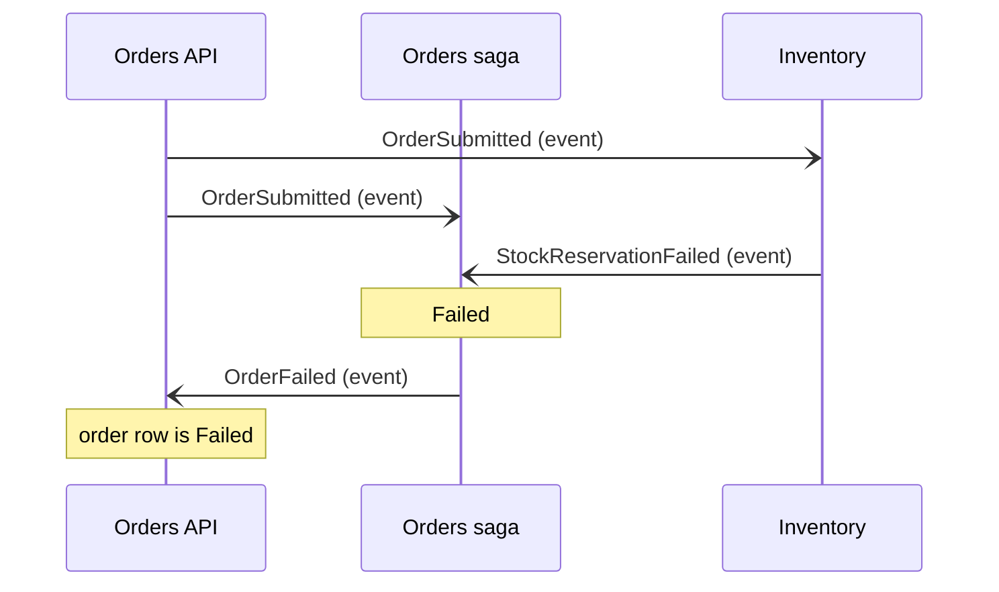
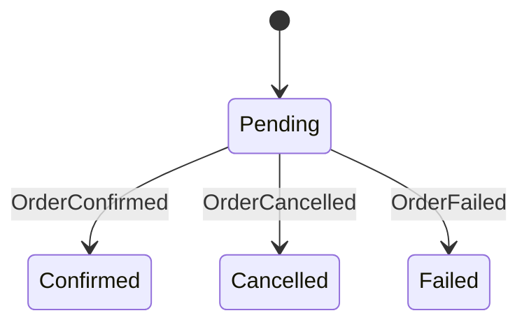

# Order flow

This page shows how an order moves through the system. The Orders saga (an orchestrator) decides every step, and Inventory and Payments only do their own work. Solid arrows with filled heads (`->>`) are calls that wait for an answer. Arrows with open heads (`-)`) are asynchronous messages.

## Happy path

## Payment fails: compensation

## Not enough stock

## Order status (the order row)

An order only leaves Pending, and it never leaves Confirmed, Cancelled or Failed. The domain methods `Confirm()`, `Cancel()` and `MarkFailed()` enforce this, and `OrderStatusTests` checks it.

The saga has more states than the order row (AwaitingStock, AwaitingPayment, Releasing). The order row shows Pending for all of them. See [order-saga.md](order-saga.md).
