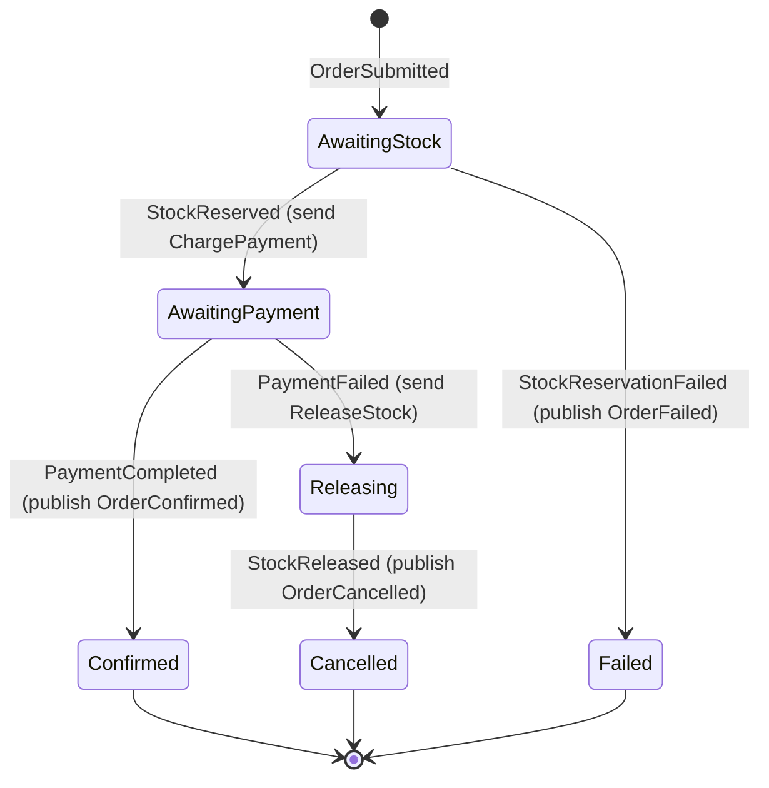

# The order saga

A saga is a long business process split into local steps (reserve stock, charge payment), where each step has a compensation if a later step fails (release stock, cancel the order).

OrderFlow first used **choreography**: each service reacted to events and nobody was in charge. Answering "where is order 123?" meant reading three logs, and the failure rules were spread across four consumers. It now uses **orchestration**: one state machine in Orders (`OrderStateMachine`, built with MassTransit) receives every event for an order, decides the next step, and sends the commands. Inventory and Payments still do their own work.

## States and transitions

| State | Meaning |
|---|---|
| AwaitingStock | The order was submitted, and the saga is waiting for Inventory |
| AwaitingPayment | Stock is reserved, and the saga is waiting for Payments |
| Releasing | Payment failed, and the saga is waiting for Inventory to confirm the stock was given back |
| Confirmed (final) | Paid and reserved |
| Failed (final) | There was not enough stock |
| Cancelled (final) | Payment failed and the stock was released |

The saga waits for `StockReleased` before it says Cancelled, instead of assuming the release worked.

## Events that arrive twice or late

Delivery is at-least-once, and retries can delay messages. Every event has a rule in every state:

- **moves:** an arrow in the diagram above.
- **ignore:** a harmless duplicate, so nothing happens.
- **flag:** dangerous. It is recorded and never obeyed.
- **error:** should never happen. It is retried and then moved to the error queue.

| Event | AwaitingStock | AwaitingPayment | Releasing | Confirmed | Cancelled | Failed |
|---|---|---|---|---|---|---|
| OrderSubmitted | ignore | ignore | ignore | ignore | ignore | ignore |
| StockReserved | moves | ignore | ignore | ignore | ignore | ignore |
| StockReservationFailed | moves | ignore | ignore | ignore | ignore | ignore |
| PaymentCompleted | error | moves | **flag** | ignore | **flag** | error |
| PaymentFailed | error | moves | ignore | ignore | ignore | error |
| StockReleased | error | error | moves | error | ignore | error |

The dangerous case is a **late PaymentCompleted in Releasing or Cancelled**. The customer was charged, but the order is being cancelled. The saga never moves to Confirmed. Instead it sets `NeedsRefund = true` and logs a warning. Refunds themselves are not built yet.

## What the saga stores

There is one row per order in the `order_states` table, in the Orders database:

| Column | Why |
|---|---|
| CorrelationId | the order's id; every message is matched to its row by `OrderId` |
| CurrentState | the state name, such as `AwaitingPayment` |
| Amount | the order total, carried in `OrderSubmitted.Total`, so the saga can send `ChargePayment` |
| ItemsJson | the order lines as JSON, so the saga can send `ReleaseStock` without reading the order tables |
| FailureReason | why stock or payment failed, passed on in `OrderFailed` or `OrderCancelled` |
| NeedsRefund | true when a payment arrived after the cancel |
| CreatedAtUtc | when the saga started |
| xmin (Version) | optimistic concurrency, so two messages for the same order cannot overwrite each other |

The saga keeps the items itself (self-contained) instead of loading them from the order tables. That duplicates a little data, but the saga does not depend on the order table layout.

The order row (`orders.Status`) is a projection of the saga. `OrderStatusConsumer` handles `OrderConfirmed`, `OrderCancelled` and `OrderFailed`, and calls the matching domain method.

## Why it survives crashes

The state lives in the database, not in memory. When a message arrives, MassTransit loads the row, runs the rule, and saves the row inside the outbox transaction. Killing Orders in the middle of an order loses nothing (Drill B in [drills.md](drills.md)): the next event waits in the saga's queue, and the restarted service continues from the saved state.

## Eventual consistency

For a short time the parts disagree. The order says Pending while Inventory has already reserved the stock, or while Payments is down and `ChargePayment` waits in its queue. This normally lasts milliseconds, and in the worst case it lasts as long as an outage. OrderFlow chooses availability over immediate consistency: you can place an order while Payments is down, and it finishes later.

## Tested by

`OrderSagaTests` (`dotnet test --filter "Category=Saga"`), with the MassTransit test harness and an in-memory saga store:

1. Happy path: ends Confirmed, sends ChargePayment with the right amount, publishes OrderConfirmed.
2. Compensation: ends Cancelled, sends ReleaseStock with the right items, publishes OrderCancelled with the reason.
3. Late PaymentCompleted after the cancel: stays Cancelled, sets NeedsRefund, and never publishes OrderConfirmed.

## Open risks

- **No timeouts.** If an event never comes (Payments down for hours, or a message in an error queue), the saga waits forever. A future timeout transition would be AwaitingPayment to Releasing on a timer.
- **No refunds.** `NeedsRefund` is only a flag.
