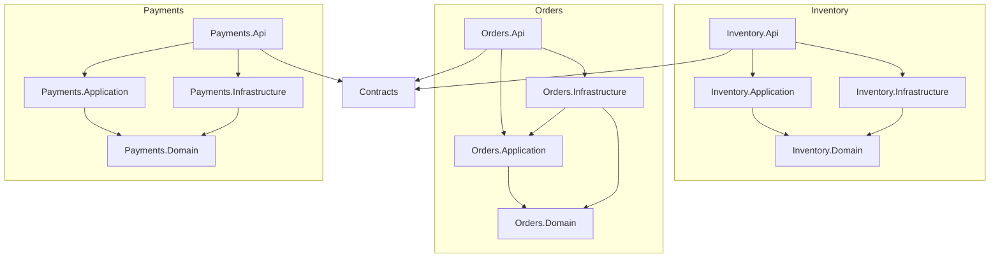

# Project references

Every service has four projects. An arrow means "references".



## Rules

- Arrows point toward Domain. Domain references nothing, so business rules never depend on EF Core, HTTP or MassTransit.
- There is no arrow between services. Inventory, Orders and Payments only share the Contracts project, which holds the message records (events and commands).
- The saga's data (`OrderState`) and its EF mapping live in Orders.Infrastructure, next to `OrdersDbContext`. The state machine (`OrderStateMachine`) lives in Orders.Api.

## Test projects

| Test project | References | What it tests |
|---|---|---|
| OrderFlow.Inventory.Tests | the project that holds `InventoryValidator` | validation rules (fast, no Docker) |
| OrderFlow.Orders.Tests | Orders.Domain, Orders.Api | order status rules and the saga (fast, no Docker) |
| OrderFlow.Inventory.IntegrationTests | Inventory.Api | the real API, the OrderSubmitted consumer and the last-unit race, all on real PostgreSQL (Testcontainers) |

Orders.Tests references Orders.Api only to reach the saga state machine. Those tests use no container or network.

## How to check

The project files always win over this diagram. To check it against them:

```
dotnet list src/Orders/OrderFlow.Orders.Api reference
dotnet list src/Orders/OrderFlow.Orders.Infrastructure reference
dotnet list src/Payments/OrderFlow.Payments.Api reference
```
