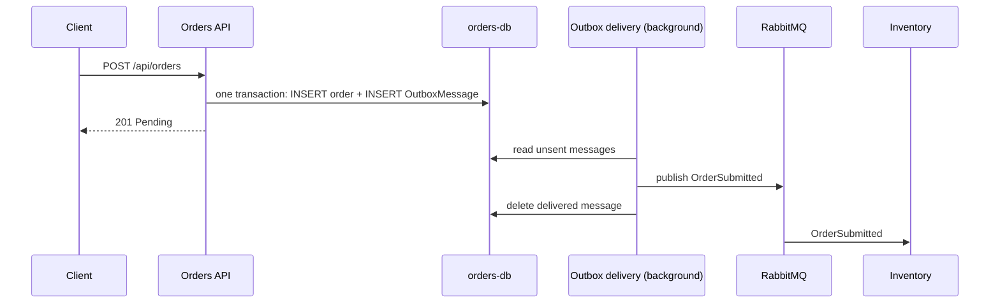

# Reliability notes

Every fix below has the same three parts: the problem, the fix, and how to see it in this repo.

## 1. Dual write

- **Problem.** Orders saved the order and published its event in two steps. A crash between them lost the event.
- **Fix.** Transactional outbox (MassTransit EF Core outbox) in every service that sends messages.
- **Proof.** The `CHAOS_CRASH_BEFORE_PUBLISH` demo in [dual-write.md](dual-write.md): the crashed order is still Confirmed after the restart.

## 2. Consumers that fail halfway

- **Problem.** Inventory saved the stock and published, then failed, leaving reduced stock and contradictory events.
- **Fix.** The outbox and inbox on every consumer endpoint. Each consumer runs inside one database transaction together with its outgoing messages.
- **Proof.** A poison order (quantity 13, with a temporary throw after the publish) leaves the stock unchanged, publishes nothing, and ends in the `_error` queue.

## 3. Messages that keep failing

- **Problem.** Temporary failures (a busy database, a network blip) and permanent ones (poison messages).
- **Fix.** Five retries with exponential backoff, then the message moves to a queue ending in `_error`. One bad message never blocks the others.
- **Proof.** The poison-message run from Session 39: growing gaps between the retry log lines, then `Ready = 1` in the error queue.

## 4. Duplicate messages

- **Problem.** RabbitMQ delivers at least once, so a redelivered `ChargePayment` could charge twice.
- **Fix.** MassTransit's inbox (`InboxState`) on every consumer, plus a `processed_messages` table and a unique index on `payments.OrderId` in Payments.
- **Proof.** The charge-twice demo from Session 41: the same MessageId sent twice gives one payment row and a "Duplicate message ... ignored" log line.

## 5. Two orders, one unit

- **Problem.** A read-then-write race on stock.
- **Fix.** Optimistic concurrency with PostgreSQL `xmin`.
- **Proof.** [concurrency.md](concurrency.md), and `dotnet test --filter "Category=Concurrency"`.

## 6. A service dies in the middle of an order

- **Problem.** A crash or outage while an order is halfway through.
- **Fix.** The saga stores its state in `order_states`, messages wait in queues or outboxes, and every step is idempotent.
- **Proof.** [drills.md](drills.md): kill Payments, kill Orders mid-saga, kill RabbitMQ. The order completes exactly once each time.

## The outbox in one picture

**In two sentences:** Orders saves the event as a row in its own database, in the same transaction as the order, so either both exist or neither does. A background process then publishes unsent rows to RabbitMQ and deletes them, so a crash only delays the event and never loses it.
