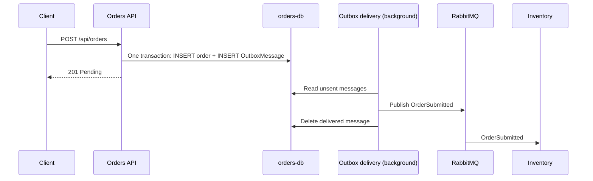

# Reliability notes (Week 10)

## 1. Dual write

**Problem:** Orders saved the order and published its event in two separate steps. A crash between them could leave a saved order without its event.

**Fix:** Use a transactional outbox, saving the order and its outgoing event in the same database transaction.

**Proof:** `docs/dual-write.md` and the `CHAOS_CRASH_BEFORE_PUBLISH` demo.

## 2. Consumers that fail halfway

**Problem:** Inventory could save a stock change and publish an event before failing, leaving inconsistent outcomes.

**Fix:** Use the transactional outbox and MassTransit's consumer inbox within the appropriate database transaction, so failed processing can be rolled back and retried consistently.

**Proof:** The poison-order demo with quantity 13 should leave inventory unchanged and avoid publishing a successful reservation event.

## 3. Duplicate messages

**Problem:** At-least-once delivery means a message may be delivered more than once, potentially causing duplicate payment processing.

**Fix:** Use MassTransit's inbox/idempotency mechanism and the `processed_messages` table in Payments to prevent duplicate processing.

**Proof:** The charge-twice demo from Session 41.

## 4. Two orders, one unit

**Problem:** Two orders can read the same available stock before either reservation is saved, causing an oversell.

**Fix:** Use optimistic concurrency with PostgreSQL `xmin`. The losing update raises a concurrency exception, and the retried order is rejected if stock is exhausted.

**Proof:** `docs/concurrency.md` and two parallel orders for `LAST-001`.

## Outbox flow

